  

 

### About

I'm a BSc IT (Data Science) student drawn to data, machine learning, and the kind of problems that matter outside a notebook.

It's about looking beyond the surface, making sense of the noise, and uncovering something meaningful along the way.

 

Currently

Fun fact: I've appeared on national television.

 

### Stack

| | |
|:--|:--|
| **Languages** |   |
| **Data & Analysis** |    |
| **Machine Learning** |   |
| **Databases** |   |

Bright blue marks what I'm learning now.

 

### Connect

 

  <i>Striving for greatness.</i>
    
  

